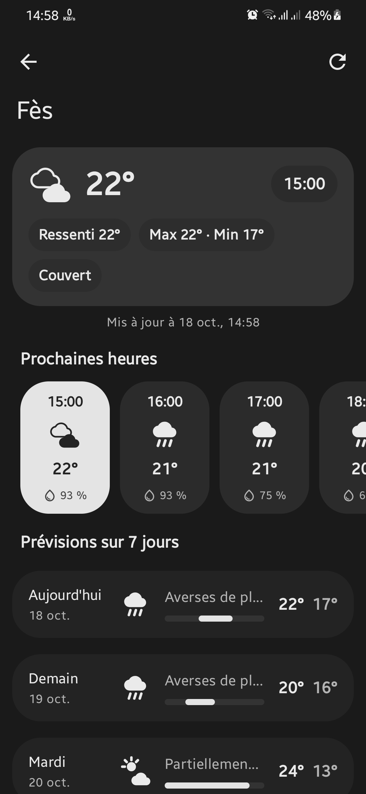
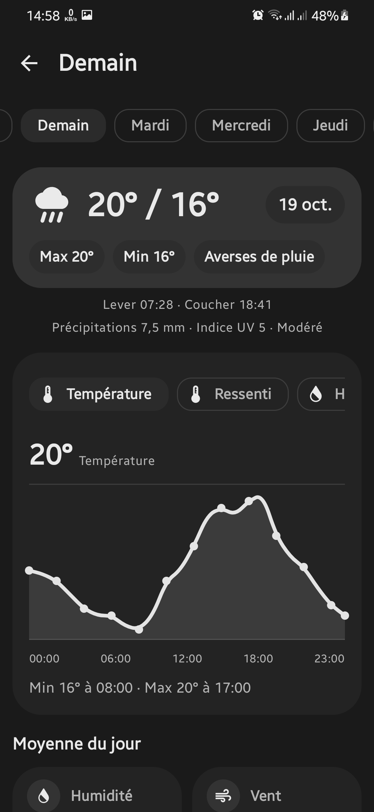
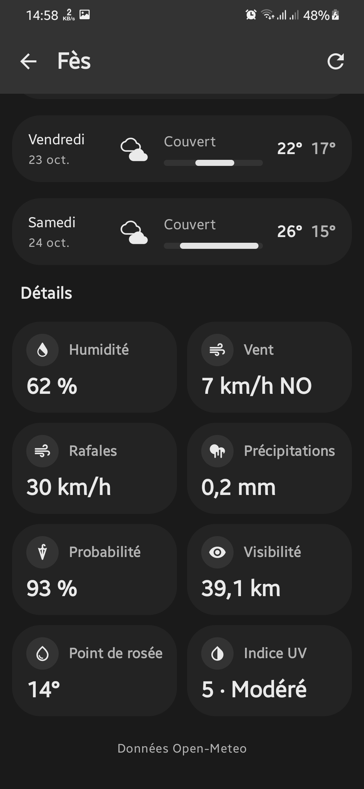

#  Météo — Material 3 Expressive Weather App for Android

[](https://android.com)
[](https://kotlinlang.org)
[](https://developer.android.com/jetpack/compose)
[](https://open-meteo.com)
[](LICENSE)

**Météo** is a native Android weather app built with **Jetpack Compose** and **Material 3 Expressive**. It combines multi-city forecasts, hourly and daily analytics, local weather alerts, air quality, smart advice, sun and moon data, and full offline caching with a highly configurable interface.

---

##  Screenshots

<p align="center">
  
  &nbsp;&nbsp;
  
  &nbsp;&nbsp;
  
</p>

<p align="center">
  <i>Left to Right: <b>Cities Overview</b> • <b>Forecast and Charts</b> • <b>Day Deep-Dive</b></i>
</p>

---

##  Key Features

###  First-Launch Onboarding
- Asks for the current location immediately and opens that city's forecast directly — no location/search chooser.
- Falls back to city search only when location permission is denied or the provider is unavailable.
- Remembers the chosen place and opens it directly on every later launch.
- The onboarding can be replayed from Settings at any time.

###  Location and City Management
- Locate the current position with Android's `LocationManager` and `Geocoder` — no Play Services dependency.
- Search worldwide cities through Open-Meteo Geocoding and save them for later.
- Add cities with the expressive floating action button menu.
- See current conditions plus today's high and low for every saved city.
- Tap a city in **My Cities** to open it and make it your current city; it is marked with a home icon and opens directly on future launches.
- Remove cities with a confirmation dialog and undo support.

###  Expressive Forecasting
- Seven-day outlook with an hourly breakdown.
- Interactive metric charts for temperature, precipitation, wind, humidity, pressure, and UV index.
- Dedicated day view with hourly insights and a full metric breakdown.
- Pull-to-refresh, adaptive flexible app bars, and animated content reveals.
- Share a concise text forecast for the current city.

###  Weather Alerts and Smart Advice
- Local, forecast-derived warnings for heat, cold, wind, heavy rain, snow, UV, thunderstorms, and fog.
- Context-aware advice for umbrellas, clothing, sun protection, wind, air quality, visibility, and hydration.
- Alerts and advice update together with the forecast. Alerts can be hidden in Settings.

###  Air Quality and Astronomy
- Air quality from the Open-Meteo Air Quality API, including European/US AQI, PM2.5, PM10, ozone, NO₂, SO₂, CO, and pollen.
- Sun and moon card with sunrise, sunset, daylight duration, moon phase, and illumination.
- Optional air quality display and dedicated settings toggle.

###  Personalisation Without Losing the Neutral Canvas
- **6 theme modes**: Auto, Very light, Light, Soft, Dark, and Very dark.
- **16 accent palettes**: Ocean, Sky, Cyan, Teal, Mint, Emerald, Lime, Sun, Amber, Coral, Rose, Berry, Violet, Indigo, Peach, and Graphite.
- **3 corner styles** (Expressive, Round, Compact) and **3 text sizes**.
- **Animation toggle** for motion-sensitive users.
- Background and primary surfaces stay neutral gray while accent colours flow through cards, containers, badges, and gradients.

###  Granular Units and Display Controls
- Temperature: Celsius or Fahrenheit, with 0–2 decimal places.
- Wind: km/h, mph, m/s, or knots.
- Precipitation: millimetres or inches.
- Distance: kilometres or miles.
- Pressure: hPa or inHg.
- Time: 12-hour or 24-hour clock.
- Toggle weather alerts and air quality.
- Clear the forecast cache, reset all preferences, or replay onboarding to find your city again.

###  Multilingual Interface
The app ships with **8 languages**:

- English
- Français (French)
- Español (Spanish)
- Deutsch (German)
- Italiano (Italian)
- Português (Portuguese)
- Türkçe (Turkish)
- Русский (Russian)

Language changes are applied immediately. Missing translations fall back to English.

###  Offline Resilience
- Forecasts and saved cities are cached locally with SQLite.
- Cached data is shown instantly and remains available when the network fails.
- Database migrations preserve saved cities when the schema evolves.

---

##  Architecture and Project Structure

Météo follows **MVVM** with **unidirectional data flow** and a single repository-backed data layer.

```
com.brahim.meteo
├── component/          # Screens, onboarding, drawer shell and navigation
├── config/             # DataStore keys and configuration persistence
├── data/               # Repository, SQLite database, Open-Meteo API client
│   └── model/          # Domain and API models
├── element/            # Reusable UI: cards, charts, feature panels, state views
├── ui/                 # Languages, locale plumbing, location requests and theme
│   └── theme/          # Material 3 Expressive theme, accents, shapes and type
├── util/               # Units, dates, alerts, advice, air quality, sharing, moon phase
└── viewModel/          # AppConfig, onboarding, cities, search, forecast, day, settings
```

### Data Flow
- `AppConfigVM` owns onboarding state, appearance, language, units, and display toggles through DataStore.
- `MeteoRepository` coordinates the Open-Meteo API, local SQLite cache, and city storage.
- Screen ViewModels expose immutable UI state over `StateFlow` and collect database/network updates.
- Composable screens receive state and callbacks; navigation and themes are composed at the app shell level.

---

##  Tech Stack

| Category | Technologies / Libraries |
| :--- | :--- |
| **Language** | Kotlin 2.2.10 |
| **UI** | Jetpack Compose 1.12.1, Material 3 Expressive `1.5.0-beta02` |
| **Architecture** | MVVM, ViewModel, StateFlow, Coroutines |
| **Navigation** | Navigation Compose with expressive transitions |
| **Networking** | Ktor 2.3.8 (CIO engine), `org.json` parsing |
| **Local storage** | SQLite via `SQLiteOpenHelper` |
| **Preferences** | Jetpack DataStore Preferences |
| **Build** | Android Gradle Plugin 9.4.1, compile/target SDK 37, min SDK 26 |

---

##  Getting Started

### Prerequisites
- **Android Studio** with support for Android Gradle Plugin 9.4.1.
- **JDK**: Java 17 or newer.
- **Android SDK**: API 37 platform and build-tools 36.0.0.
- **Min SDK**: 26 (Android 8.0 Oreo).
- **Target SDK**: 37.

### Build Instructions

1. **Clone the repository**:
   ```bash
   git clone https://github.com/your-username/Weather.git
   cd Weather
   ```

2. **Open the project** in Android Studio, or configure `local.properties` with your SDK path.

3. **Build the debug APK**:
   ```bash
   bash ./gradlew :app:assembleDebug
   ```
   If your checkout has an executable `gradlew`, `./gradlew :app:assembleDebug` also works.

4. **Install on a connected device**:
   ```bash
   adb install -r app/build/outputs/apk/debug/app-debug.apk
   ```

5. **Run unit tests**:
   ```bash
   bash ./gradlew :app:testDebugUnitTest
   ```

---

##  Testing

The unit test suite covers utility formatters, date and time formatting, wind direction labels, number formatting, UV index handling, weather condition mapping, weather alerts, AQI thresholds and pollen, and moon phases.

```bash
bash ./gradlew :app:testDebugUnitTest --info
```

Build verification:

```bash
bash ./gradlew :app:compileDebugKotlin :app:assembleDebug
```

---

##  Data Attribution

- Weather, geocoding, and air quality data: [Open-Meteo](https://open-meteo.com).
- Weather icons: AmCharts and Home Assistant (MIT).

---

##  License

```text
MIT License

Copyright (c) 2026 Brahim

Permission is hereby granted, free of charge, to any person obtaining a copy
of this software and associated documentation files (the "Software"), to deal
in the Software without restriction, including without limitation the rights
to use, copy, modify, merge, publish, distribute, sublicense, and/or sell
copies of the Software, and to permit persons to whom the Software is
furnished to do so, subject to the following conditions:

The above copyright notice and this permission notice shall be included in all
copies or substantial portions of the Software.

THE SOFTWARE IS PROVIDED "AS IS", WITHOUT WARRANTY OF ANY KIND, EXPRESS OR
IMPLIED, INCLUDING BUT NOT LIMITED TO THE WARRANTIES OF MERCHANTABILITY,
FITNESS FOR A PARTICULAR PURPOSE AND NONINFRINGEMENT. IN NO EVENT SHALL THE
AUTHORS OR COPYRIGHT HOLDERS BE LIABLE FOR ANY CLAIM, DAMAGES OR OTHER
LIABILITY, WHETHER IN AN ACTION OF CONTRACT, TORT OR OTHERWISE, ARISING FROM,
OUT OF OR IN CONNECTION WITH THE SOFTWARE OR THE USE OR OTHER DEALINGS IN THE
SOFTWARE.
```
