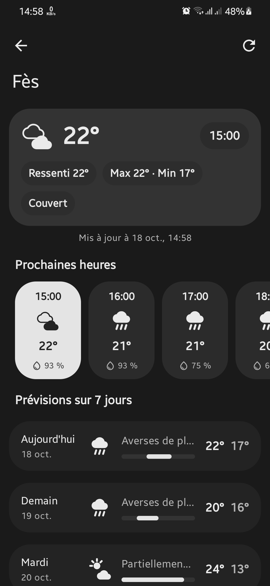
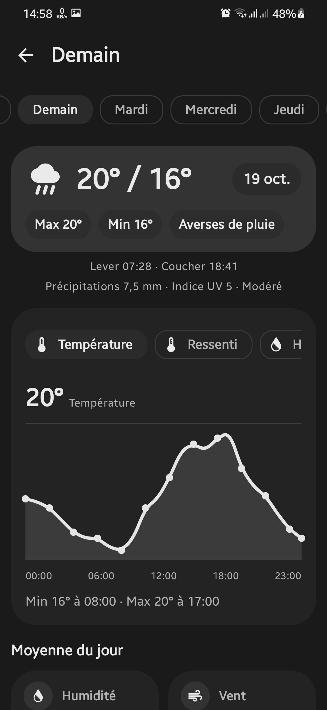
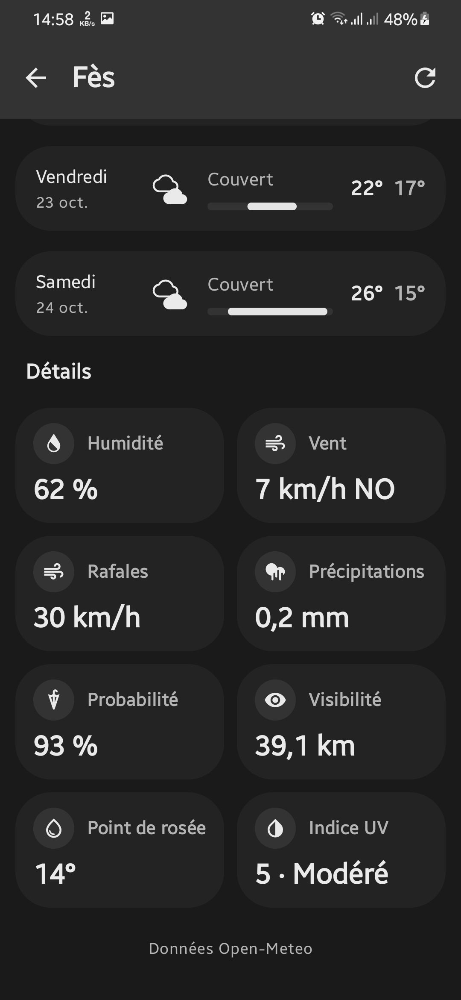

#  Météo — Material 3 Expressive Weather App for Android

[](https://android.com)
[](https://kotlinlang.org)
[](https://developer.android.com/jetpack/compose)
[](https://open-meteo.com)
[](release/)
[](LICENSE)

**Météo** is a native Android weather app built with **Jetpack Compose** and **Material 3 Expressive**. It combines multi-city forecasts, hourly and daily analytics, local weather alerts, priority-ranked smart advice, sun and moon data, air quality and full offline caching with a highly configurable interface.

The forecast screen is built around a **living sky**: the whole page takes its colour from the current conditions and animates with them — drifting clouds, falling rain, twinkling stars, a glowing sun or moon — in the style of Google Pixel Weather.

---

## Screenshots

<p align="center">
  
  &nbsp;&nbsp;
  
  &nbsp;&nbsp;
  
</p>

<p align="center">
  <i>Left to Right: <b>Cities Overview</b> • <b>Forecast and Charts</b> • <b>Day Deep-Dive</b></i>
</p>

---

## Key Features

###  Living Sky (Pixel Weather style)
- The forecast background is a **dynamic gradient** derived from the WMO weather code and the day/night flag, and it **cross-fades** whenever the conditions change.
- **Ambient particles** react to the sky: drifting clouds, slanting rain, drifting snow, twinkling stars, fog banks and lightning flashes.
- A **sun or moon glow** breathes behind the forecast header.
- The sky fades seamlessly into the page background at the top and the bottom, so the gradient never ends on a hard edge.
- The palette is resolved from the theme accent, so the sky always stays in the family of the chosen colours.

###  Expressive Shapes
- **15 official Material 3 Expressive silhouettes** (`Cookie4Sided`, `Cookie9Sided`, `Cookie12Sided`, `Gem`, `Boom`, `Arch`, `Pill`, `Flower`, `PixelCircle`, `Puffy`, `Burst`, `ClamShell`, `Sunny`, `Pentagon`, `Triangle`) are used across tiles, badges, city cards and hourly chips.
- A custom **`SquircleShape`**: a continuous-corner superellipse outline, so surfaces curve out of their own edges instead of being rectangles with cut corners.
- **5 corner styles**: Expressive, Round, Compact, Squircle and Pilled — each applied to every surface in the app.
- Shape variety is applied deterministically, so a grid of tiles reads as a family rather than a random mix.

###  Smooth Motion
- Every motion is driven by a single `Motion` spec set (emphasised decelerate / accelerate, spring, bouncy and drift) and can be switched off globally for motion-sensitive users.
- **Staggered reveals** for every card, **springing presses** on tappable tiles, **count-up temperatures**, **cross-fading values** and **springing compass needles**.
- The sun-path marker slides along its arc, the air quality bars grow out of their track and the sky gradient morphs instead of cutting.

###  Expressive Launch
- Native Android splash hand-off plus a one-second animated Compose splash using Material 3 Expressive shapes and motion.
- App content and onboarding warm up underneath the splash, so the first interactive screen is ready without a blank frame.
- Loading states stay visible for at least 500 ms, avoiding a one-frame spinner flash on fast cache reads.
- Minimal adaptive launcher icon with a small scalloped sun in gray, using the Material 3 Expressive shape language.

###  First-Launch Onboarding
- Asks for the current location immediately and opens that city's forecast directly — no location/search chooser.
- Falls back to city search only when location permission is denied or the provider is unavailable.
- Remembers the chosen place and opens it directly on every later launch.
- The onboarding can be replayed from Settings at any time.

###  Location and City Management
- Locate the current position with Android's `LocationManager` and `Geocoder` — no Play Services dependency.
- Search worldwide cities through Open-Meteo Geocoding and save them for later.
- Add cities with the expressive floating action button menu.
- See current conditions plus today's high and low for every saved city.
- Tap a city in **My Cities** to open it and make it your current city; it is marked with a home icon and opens directly on future launches.
- Remove cities with a confirmation dialog and undo support.

###  Expressive Forecasting
- **Ten-day** outlook with a 24 hour breakdown.
- Interactive metric charts for temperature, precipitation, wind, humidity, pressure and UV index.
- **Sun path arc** that draws the sun travelling between sunrise and sunset with a marker on the current time.
- **Wind compass** dial that springs to the direction the wind blows from.
- Dedicated day view with hourly insights and a full metric breakdown.
- Pull-to-refresh, adaptive flexible app bars, and animated content reveals.

###  Air Quality
- Current **US AQI** and **European AQI** read from the Open-Meteo air quality endpoint.
- Six air quality bands, from *Good* to *Hazardous*.
- Breakdown of **PM2.5, PM10, Ozone and NO₂** with bars that grow into place.
- The air quality endpoint is optional: if it is unavailable the rest of the forecast still works.

###  Weather Alerts and Smart Advice
- Local, forecast-derived warnings for heat, cold, wind, heavy rain, snow, UV, thunderstorms, and fog.
- Priority-ranked advice with live values for storms, snow, umbrellas, clothing, heat, UV, wind, visibility, humidity, and hydration.
- A calm-weather fallback so the advice card is always useful.
- Alerts and advice update together with the forecast. Alerts can be hidden in Settings.

###  Astronomy
- Sun and moon card with sunrise, sunset, daylight duration, moon phase, and illumination.
- The moon phase is also available as a tile in the conditions grid.

###  Personalisation Without Losing the Neutral Canvas
- **6 theme modes**: Auto, Very light, Light, Soft, Dark, and Very dark.
- **16 accent palettes**: Ocean, Sky, Cyan, Teal, Mint, Emerald, Lime, Sun, Amber, Coral, Rose, Berry, Violet, Indigo, Peach, and Graphite.
- **5 corner styles** (Expressive, Round, Compact, Squircle, Pilled) and **3 text sizes**.
- **Animation toggle** for motion-sensitive users.
- Background and primary surfaces stay neutral gray while accent colours flow through cards, containers, badges, and gradients.

###  Display and Data Controls
- Toggle weather alerts.
- Clear the forecast cache, reset all preferences, or replay onboarding to find your city again.
- Settings stay intentionally compact: appearance, language, alerts, and data actions only.

###  Multilingual Interface
The app ships with **8 languages**:

- English
- Français (French)
- Español (Spanish)
- Deutsch (German)
- Italiano (Italian)
- Português (Portuguese)
- Türkçe (Turkish)
- Русский (Russian)

Language changes are applied immediately. Missing translations fall back to English.

###  Offline Resilience
- Forecasts, air quality and saved cities are cached locally with SQLite.
- Cached data is shown instantly and remains available when the network fails.
- Database migrations preserve saved cities when the schema evolves.

---

## Architecture and Project Structure

Météo follows **MVVM** with **unidirectional data flow** and a single repository-backed data layer.

```
com.brahim.meteo
├── component/          # Screens, onboarding, drawer shell and navigation
├── config/             # DataStore keys and configuration persistence
├── data/               # Repository, SQLite database, Open-Meteo API client
│   └── model/          # Domain and API models
├── element/            # Reusable UI: cards, charts, feature panels, sky backdrop
├── ui/                 # Languages, locale plumbing, location requests and theme
│   └── theme/          # Material 3 Expressive theme, accents, shapes, motion, sky
├── util/               # Formatting, dates, alerts, advice, city matching, moon phase, AQI
└── viewModel/          # AppConfig, onboarding, cities, search, forecast, day, settings
```

### Data Flow
- `AppConfigVM` owns onboarding state, appearance, language, and display toggles through DataStore.
- `MeteoRepository` coordinates the Open-Meteo API, local SQLite cache, and city storage.
- Screen ViewModels expose immutable UI state over `StateFlow` and collect database/network updates.
- Composable screens receive state and callbacks; navigation and themes are composed at the app shell level.

---

## Tech Stack

| Category | Technologies / Libraries |
| :--- | :--- |
| **Language** | Kotlin 2.2.10 |
| **UI** | Jetpack Compose 1.12.1, Material 3 Expressive `1.5.0-beta02` |
| **Architecture** | MVVM, ViewModel, StateFlow, Coroutines |
| **Navigation** | Navigation Compose with expressive transitions |
| **Networking** | Ktor 2.3.8 (CIO engine), `org.json` parsing |
| **Local storage** | SQLite via `SQLiteOpenHelper` |
| **Preferences** | Jetpack DataStore Preferences |
| **Build** | Android Gradle Plugin 9.4.1, compile/target SDK 37, min SDK 26 |

---

## Getting Started

### Prerequisites
- **Android Studio** with support for Android Gradle Plugin 9.4.1.
- **JDK**: Java 17 or newer.
- **Android SDK**: API 37 platform and build-tools 36.0.0.
- **Min SDK**: 26 (Android 8.0 Oreo).
- **Target SDK**: 37.

### Build Instructions

1. **Clone the repository**:
   ```bash
   git clone https://github.com/brahimlakhal3/KOTLIN_WEATHER.git
   cd KOTLIN_WEATHER
   ```

2. **Open the project** in Android Studio, or configure `local.properties` with your SDK path.

3. **Build the debug APK**:
   ```bash
   bash ./gradlew :app:assembleDebug
   ```
   If your checkout has an executable `gradlew`, `./gradlew :app:assembleDebug` also works.

4. **Install on a connected device**:
   ```bash
   adb install -r app/build/outputs/apk/debug/app-debug.apk
   ```

5. **Run unit tests**:
   ```bash
   bash ./gradlew :app:testDebugUnitTest
   ```

### Signed Release Build

The release build is signed with the keystore described in **[SIGNING_INFO.txt](SIGNING_INFO.txt)**.

1. Place the keystore at the path recorded in `SIGNING_INFO.txt` (the repository root).
2. Create `keystore.properties` in the repository root:
   ```properties
   storeFile=meteo-release.jks
   storePassword=<your store password>
   keyAlias=meteo
   keyPassword=<your key password>
   ```
   `keystore.properties` and `*.jks` are listed in `.gitignore` and are never committed.

3. Build the signed APK:
   ```bash
   bash ./gradlew :app:assembleRelease
   ```
   The artifact is written to `app/build/outputs/apk/release/app-release.apk`.

4. Verify the signature:
   ```bash
   apksigner verify --print-certs app/build/outputs/apk/release/app-release.apk
   ```

A prebuilt, signed **Météo 1.1.0** APK is published in the [`release/`](release/) folder.

---

## Testing

The unit test suite covers utility formatters, date and time formatting, wind direction labels, number formatting, UV index handling, weather condition mapping, weather alerts, priority-ranked smart advice, city proximity matching, moon phases and air quality bands.

```bash
bash ./gradlew :app:testDebugUnitTest --info
```

Build verification:

```bash
bash ./gradlew :app:compileDebugKotlin :app:assembleDebug
```

---

## Data Attribution

- Weather, geocoding and air quality data: [Open-Meteo](https://open-meteo.com).
- Weather icons: AmCharts and Home Assistant (MIT).

---

## License

```text
2026 MIT License

Copyright (c) 2026 Brahim

Permission is hereby granted, free of charge, to any person obtaining a copy
of this software and associated documentation files (the "Software"), to deal
in the Software without restriction, including without limitation the rights
to use, copy, modify, merge, publish, distribute, sublicense, and/or sell
copies of the Software, and to permit persons to whom the Software is
furnished to do so, subject to the following conditions:

The above copyright notice and this permission notice shall be included in all
copies or substantial portions of the Software.

THE SOFTWARE IS PROVIDED "AS IS", WITHOUT WARRANTY OF ANY KIND, EXPRESS OR
IMPLIED, INCLUDING BUT NOT LIMITED TO THE WARRANTIES OF MERCHANTABILITY,
FITNESS FOR A PARTICULAR PURPOSE AND NONINFRINGEMENT. IN NO EVENT SHALL THE
AUTHORS OR COPYRIGHT HOLDERS BE LIABLE FOR ANY CLAIM, DAMAGES OR OTHER
LIABILITY, WHETHER IN AN ACTION OF CONTRACT, TORT OR OTHERWISE, ARISING FROM,
OUT OF OR IN CONNECTION WITH THE SOFTWARE OR THE USE OR OTHER DEALINGS IN THE
SOFTWARE.
```
